# biz-agent

**企业业务智能体平台**

biz-agent 将 AI 对话、企业知识和业务工具集中在一个工作空间。你可以创建面向不同岗位的 Agent，为它配置职责、模型、知识库与技能，通过对话查询信息、分析数据、处理业务，并查看每一步的执行过程。

平台提供 Agent 发布管理、部门群聊、知识库、技能与插件、模型管理、MCP 工具接入、IM 机器人，以及审批、审计和运行监控。

## 技术基础

系统以 **Pi Agent 运行时**为基础，结合企业业务能力和 Web 控制台构建。

| 层面 | 使用的技术 | 在系统中的作用 |
| --- | --- | --- |
| Agent 运行时 | Pi 的 `pi-agent-core`、`pi-coding-agent` | 驱动模型与工具交互，管理会话历史、分支、排队消息、摘要压缩和会话导出 |
| 模型接入 | Pi AI 与多模型管理 | 统一接入模型供应商，支持流式回复、工具调用、对话模型与向量模型选择 |
| 前端界面 | Vue 3、Naive UI、Vue Router、Vite | 构建工作台、Agent 对话与各功能模块，支持桌面和窄屏布局 |
| 服务端 | Node.js、TypeScript | 提供业务接口、实时对话事件、技能装配、权限校验与审批协调 |
| 数据与检索 | SQLite / PostgreSQL、pgvector | 保存 Agent、会话、技能和平台配置，支持文档与向量检索 |
| 能力扩展 | MCP、Pi Skills 与插件 | 接入外部工具服务，安装可复用技能，扩展 Agent 可执行的任务 |
| 企业管理 | JWT、角色权限、审计与调用链 | 管理访问权限，跟踪操作与执行情况 |

Pi 负责模型执行和会话生命周期，平台围绕它提供岗位 Agent、业务技能、知识库、部门协作及管理界面。企业业务工具按需注册，技能决定适用方法与步骤，高风险操作交由人工确认。

## 系统概览

工作台集中展示可用 Agent、最近对话、待处理审批和知识库文档，方便继续已有任务或发起新的业务对话。

> 本文截图来自隔离的演示环境，使用示例数据与模拟模型展示界面和业务执行过程。实际回答和执行效果取决于接入的模型、知识资料与业务工具。

## 核心功能

### 创建与发布 Agent

为销售分析、客户服务、财务审核等岗位创建专属 Agent，统一配置名称、职责指令、模型、技能和知识库，并按需要调整记忆与执行设置。

- 支持草稿编辑、测试、发布、停用和召回。
- 发布后的 Agent 拥有独立对话入口，历史会话按 Agent 管理。
- 已发布配置需召回草稿后修改，停用后保留历史记录。
- 每个 Agent 可以组合不同的模型、资料与技能，适应各自的业务职责。
- 配置涵盖基础信息、人格与指令、模型策略、记忆、能力绑定和高级设置。创建对话时保存配置快照，便于历史任务继续执行。

### 通过对话完成业务任务

在普通对话中处理临时问题，也可以进入已发布 Agent 的专属页面开展工作。对话支持流式回复、附件、Markdown 内容、代码块与复制操作。

- **执行过程可见**。逐轮展示任务耗时，展开工具记录可查看调用状态、参数、结果和耗时。
- **快捷使用技能与命令**。输入 `/` 查找技能、压缩上下文、切换计划模式或进入 MCP 管理；模型在输入区域选择，会话操作集中在历史列表的右键菜单。
- **延续长任务**。查看上下文用量，使用手动或自动摘要压缩，并保留可见的历史对话与压缩标记。
- **探索不同分支**。通过 Pi 会话树查看历史节点、添加标签、切换分支，或从用户消息创建独立对话。
- **整理与分享会话**。支持搜索、置顶、重命名、归档、复制会话，以及导出会话历史和 HTML 报告。
- **切换任务不串台**。直接打开历史或新会话时同步左侧选中状态，快速切换以最后一次选择为准。未发送的文字草稿按会话在当前页面内分别暂存，刷新或关闭页面后不保留。
- **控制执行节奏**。支持停止当前任务，运行时追加的后续消息进入队列。计划模式用于先梳理方案，再按确认的任务继续执行。

#### 斜杠菜单与会话统计

输入 `/` 即可搜索业务技能、已导入的 Pi 技能和常用执行命令。右击历史会话，可以查看统计、压缩、重命名、置顶、归档、复制或导出会话；统计面板展示消息、工具调用、token 和费用等 Pi 会话信息。

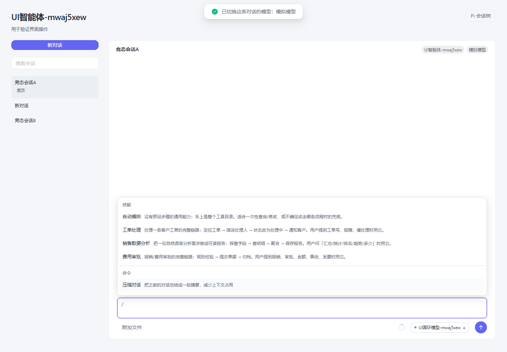

#### 上下文记忆与会话分支

长对话通过模型摘要压缩上下文，保留近期交互和可见历史，并在消息中展示压缩记录。工作空间和 Agent 都可配置压缩策略，实际压缩需要可用的真实模型。

Pi 会话树展示历史节点和分支，可为节点添加标签、从历史位置继续、从用户消息分叉，或复制当前活动分支。分支切换同步恢复对应的技能和步骤状态。

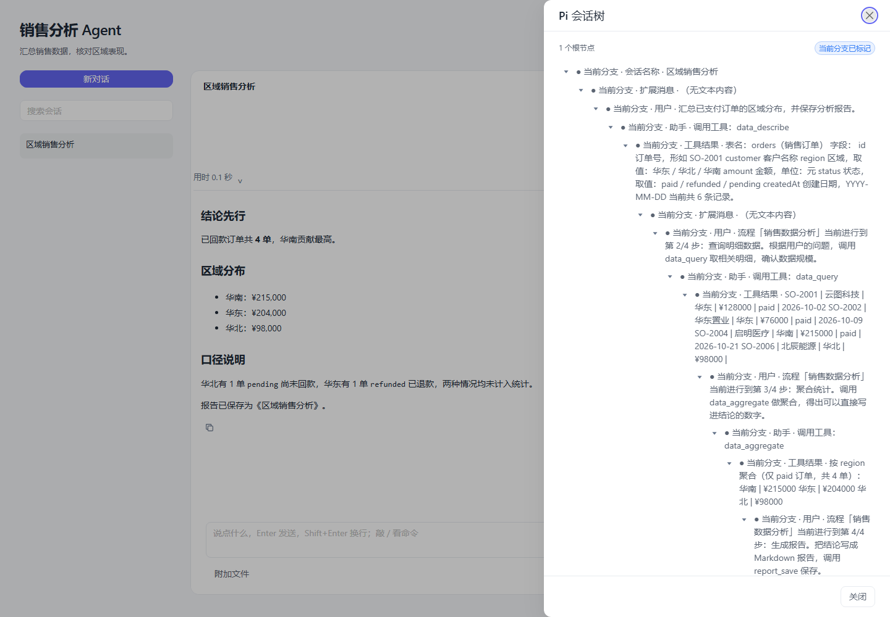

### 部门群聊协作

将销售、财务、交付、风控等岗位 Agent 组织成协作群，围绕同一事项讨论。群聊配置页集中管理群组、参与成员和协作方式，对话页可随时查看成员及其职责。

- **顺序协作**。按成员顺序发言，后续部门参考本轮前序意见；用户可以通过 `@` 选择本次参与的成员。
- **主持协作**。指定一个主持 Agent，根据事项分派部门、提出待评审方案，并针对分歧推动多轮讨论。
- **点名优先接话**。部门之间通过 `@` 请求补充，被点名成员优先回应，已发言的成员也可再次接话。
- **共识与统一汇总**。只有参与部门都明确同意当前完整方案、且没有未回应的点名时，才确认共识。达到讨论轮数或调用上限时，保留未决事项并由主持汇总。
- **讨论过程可见**。展示主持分派、部门意见、同意或分歧状态、当前轮数、调用次数和最终汇总；支持停止正在执行的讨论。

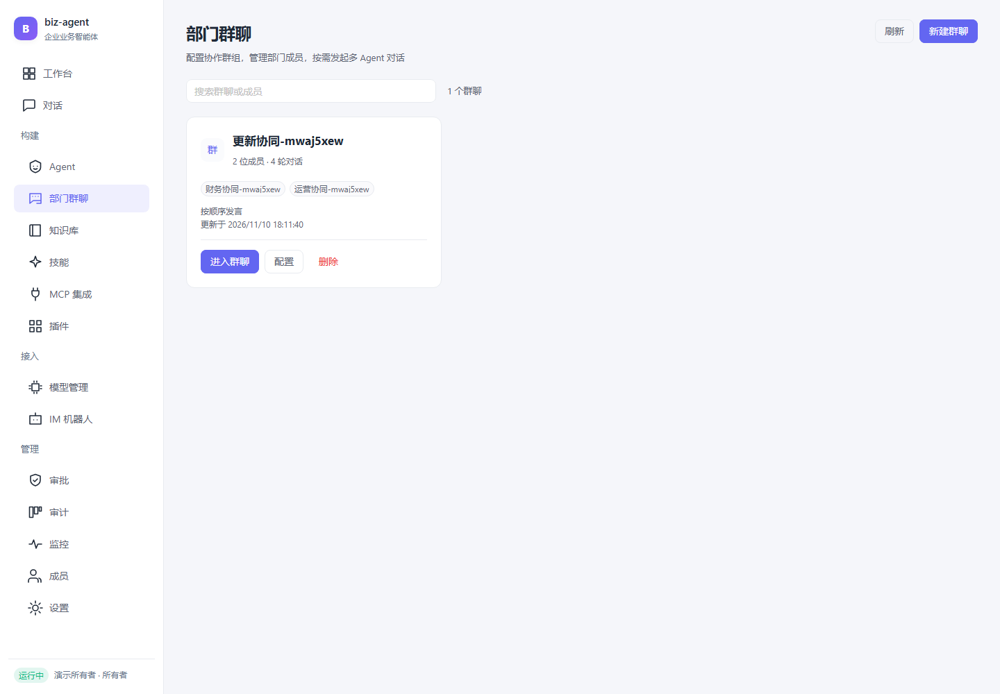

#### 一个群组，多个独立对话

同一组部门 Agent 可以围绕不同事项新建对话，通过历史下拉框切换。各对话分别保存消息、部门会话和讨论上下文，原有记录继续保留，刷新后恢复当前选择。同一群组一次处理一个事项，避免同时调度产生冲突。

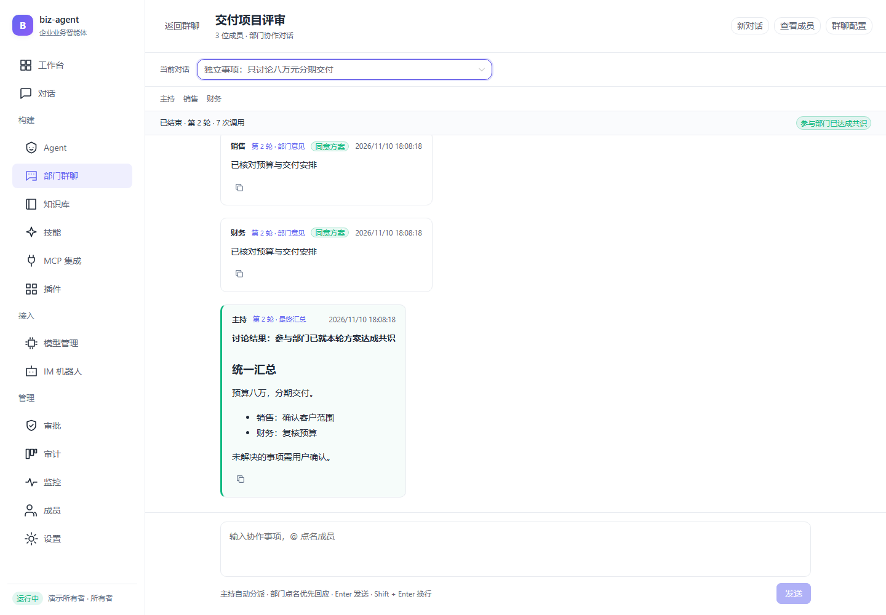

对话标题和输入区域固定，消息在中间区域滚动。输入 `@` 可选择成员，Enter 发送，Shift + Enter 换行；窄屏也保留输入和主要操作入口。

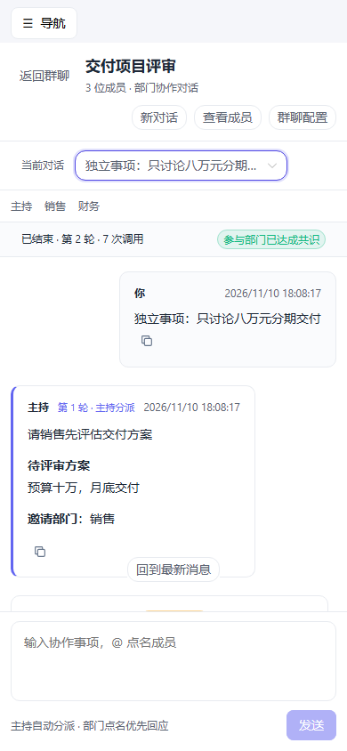

### 企业知识库

将企业制度、服务规范、产品资料和常见问题整理成知识库，供 Agent 在回答和执行任务时检索参考。

- 支持上传 TXT、Markdown、PDF、Word 和 CSV 文件。
- 查看文档处理状态，使用实际业务问题试跑检索。
- 支持关键词与语义检索，并可按需要重新生成文档向量。
- 为 Agent 或技能绑定知识库，也可设置普通对话的默认检索范围。
- 查看命中内容与来源位置，回到原文核实依据。

### 技能与业务编排

将可复用的业务方法整理成技能，写明适用场景和作业指导书。需要固定执行顺序时，可配置步骤与可用工具。

对话中可以加载、切换或退出技能，模型也可以根据任务选择合适的技能。内置示例覆盖工单处理、销售数据分析和费用审批。

简单任务可按需调用单个工具，固定业务方法可通过技能逐步执行，也可将完整任务委托给子 Agent 并汇总结果。新建或修改自定义技能后，可在会话中直接加载使用。

### 插件与 Pi 技能导入

插件页统一管理安装来源、版本、能力和启用状态。

- **插件清单导入**。安装包含技能和外部 MCP 服务声明的能力包。
- **Pi 技能导入**。粘贴 `SKILL.md` 内容，将作业指导书加入技能目录。
- **GitHub 目录导入**。从公开仓库导入技能正文及参考资料、素材和脚本文件，资源随技能保存，导入过程只保存文件内容。
- **生命周期管理**。启用、停用或卸载插件，并在活动会话中刷新已安装技能资源。

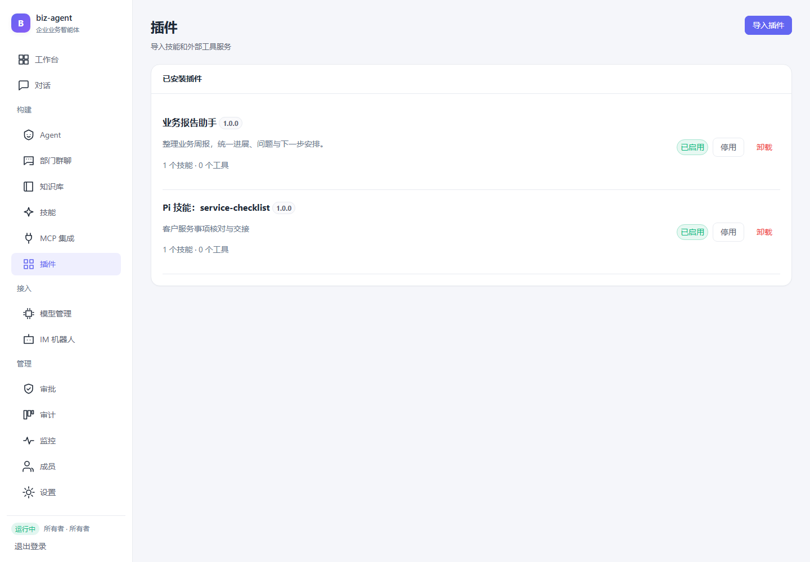

### 多模型管理

统一管理模型供应商、对话模型和知识检索所需的向量模型。支持供应商配置、模型新增与编辑、启停、连通性测试，以及默认对话模型和默认向量模型的分别选择。

模型最大上下文以 `k` 展示和设置。Agent 可以指定模型，单个会话也可以切换模型并保存选择。供应商凭证加密保存，界面以掩码展示。

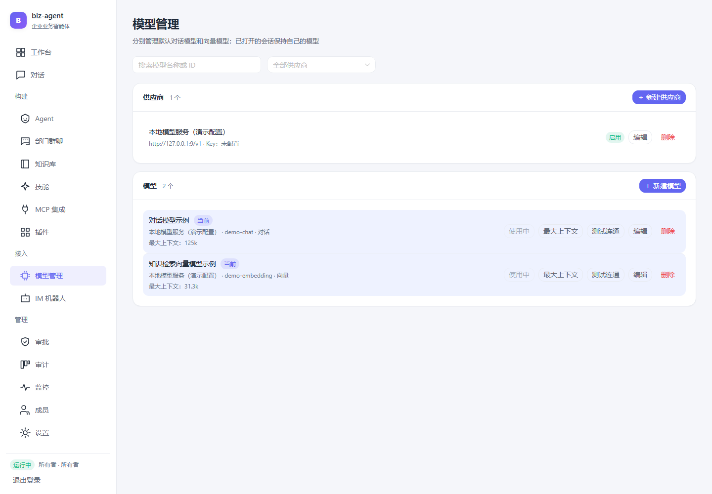

### MCP 外部工具

通过 MCP 将外部系统的工具接入平台，供 Agent 在任务中调用。

- 支持本地进程、HTTP 和 SSE 工具服务。
- 查看连接状态、发现的工具及其参数结构，按需要启用或停用工具。
- 在控制台输入参数测试工具调用，核对服务是否可用。
- 工具进入会话后受权限和风险规则约束，需要确认的操作进入审批。

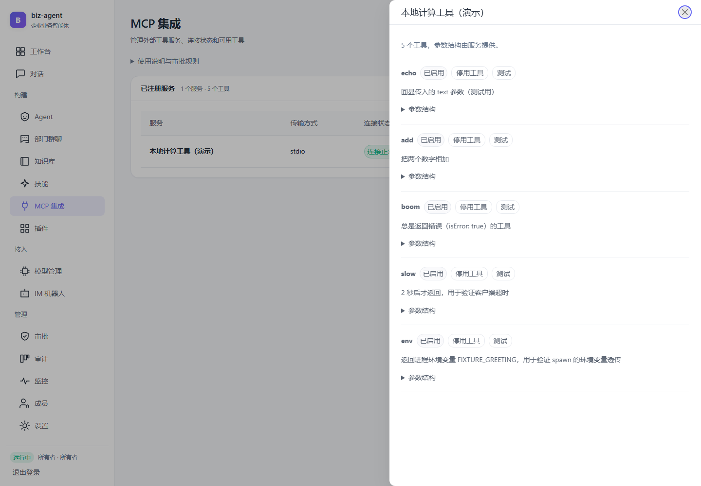

### IM 机器人

支持钉钉与企业微信自建应用，将企业消息渠道中的请求交给 Agent 处理。

机器人可绑定业务技能，按外部会话延续对话。控制台提供机器人配置、回调地址复制、启停、测试发送，以及最近回调时间和外部会话数量展示。

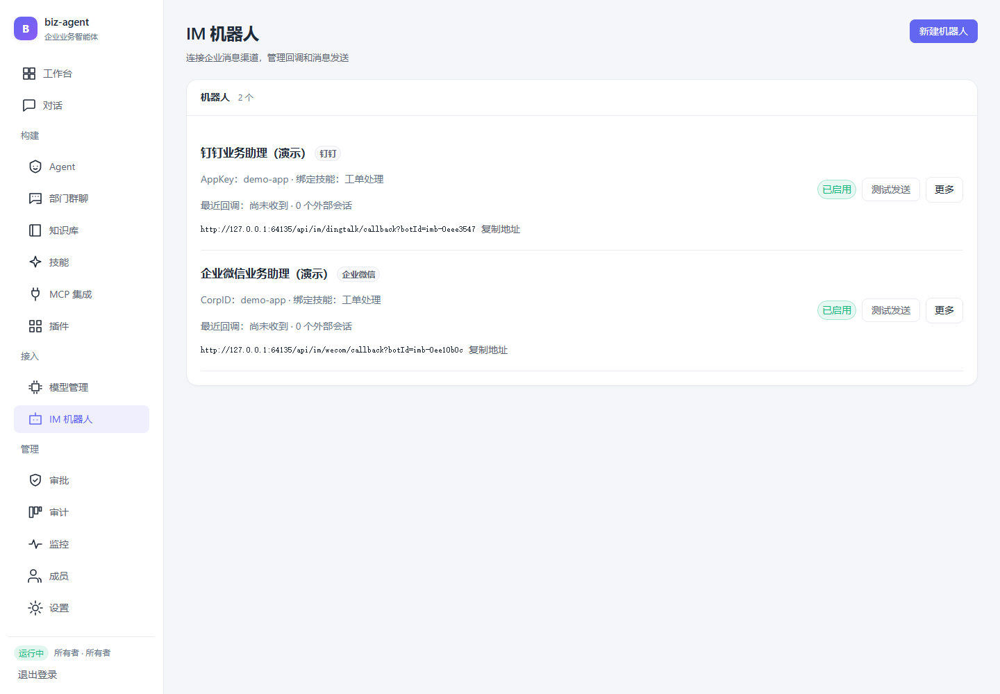

实际消息收发需要完成对应平台的应用、凭证和回调配置。文中截图展示演示配置。

### 人工审批

高风险工具执行前暂停并等待确认。用户可以在原对话或审批中心查看待办、核对操作目标和参数，选择批准并继续或拒绝。

审批中心汇总各会话的挂起操作，展示发起时间、风险、申请信息与原会话入口，并定时刷新。待办随当前执行保存在内存中，服务重启后需重新发起，操作记录可在审计中查看。

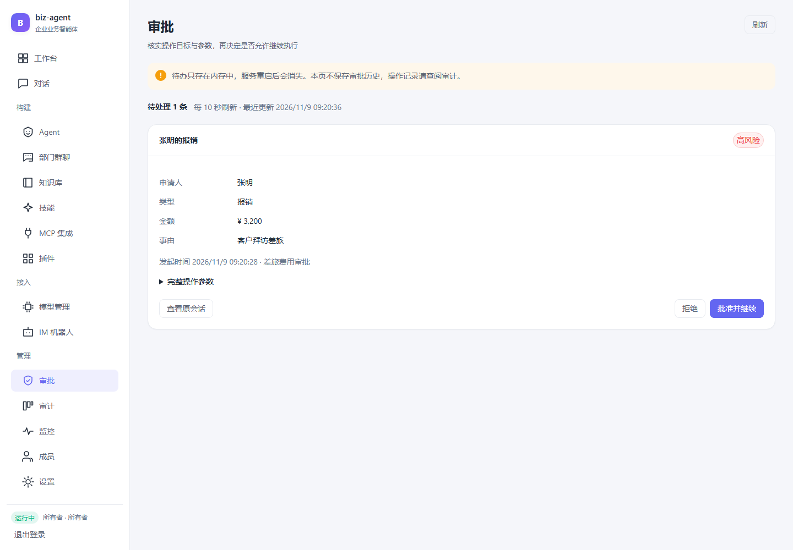

### 审计追溯

查询平台操作和工具执行记录，按时间、执行者、目标与关键词筛选，结合详情核对发生了什么、由谁发起、作用于哪个对象以及执行结果。

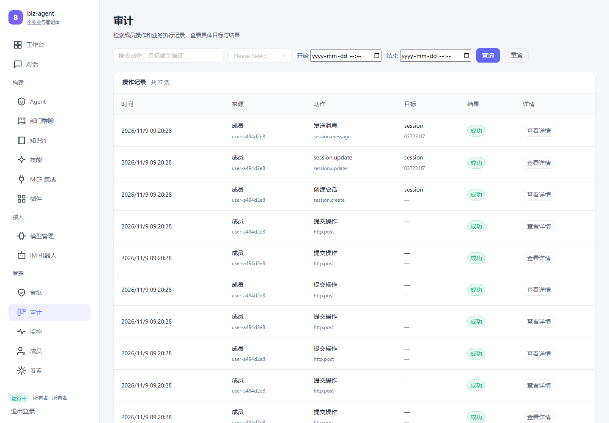

### 运行监控

查看模型、技能和工具的调用情况，包括请求量、失败情况、工具调用量和耗时。支持切换时间范围、浏览调用链列表、展开事件时间线和查看具体事件详情，便于定位模型或工具执行问题。

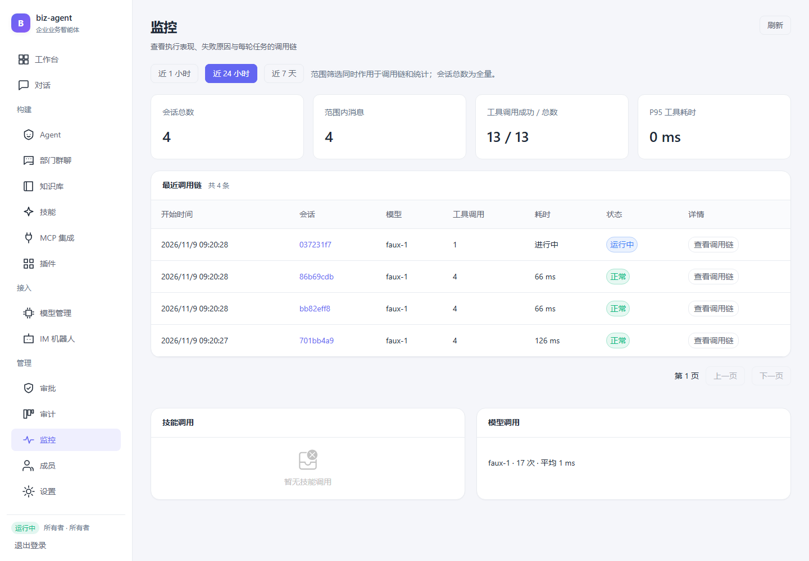

### 成员与角色权限

成员管理支持账号创建、姓名和角色调整、停用、启用与删除。平台提供所有者、开发者、运营和审计员四种角色，按角色控制功能访问和操作权限。

成员状态和角色变更会在后续请求中生效，并对自身账号修改和最后一个启用所有者提供保护。

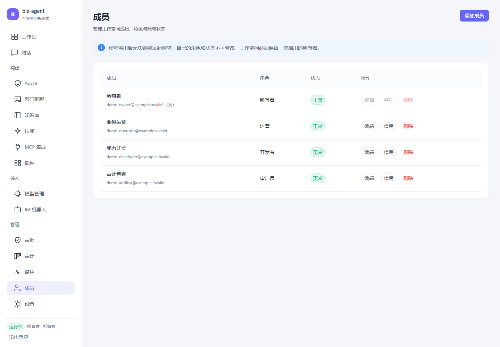

### 工作空间设置与开放接口

设置页展示登录验证、模型运行模式、存储后端和会话数。可调整新建普通会话的 Pi 自动压缩开关、预留上下文阈值与摘要后保留量，Agent 会话优先使用自身记忆配置。

开放接口提供普通和流式对话调用，以及服务健康查询。通过 API Key 为外部应用设置角色和每分钟调用上限，支持停用与吊销。创建时显示一次完整密钥，便于按应用分别管理接入权限。

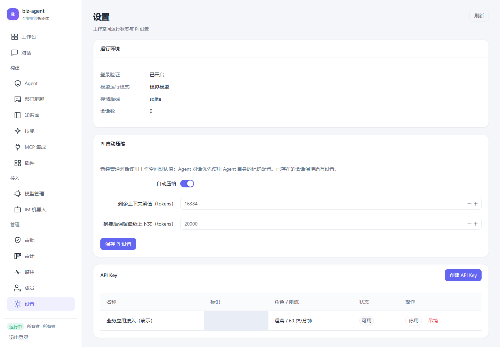

### 桌面与移动端布局

桌面布局便于同时查看历史会话、任务进展和工具结果。窄屏下收起导航与会话栏，保留对话、输入和主要操作入口，便于继续已有任务。

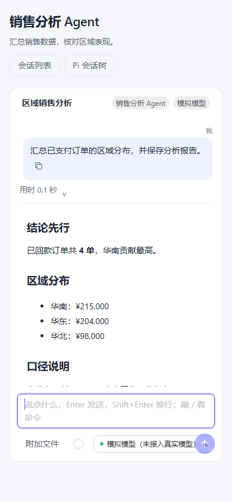

### 编码 Agent 命令行

项目还提供面向代码工作的命令行入口，支持在指定工作目录内读取与写入文件、搜索代码、执行命令及 Git 操作，并通过审批确认高风险动作。会话同样使用 Pi 的历史管理与上下文压缩能力。

## 业务场景

| 场景 | 使用方式 |
| --- | --- |
| 客户服务 | 查询工单、核实问题、指派处理人员、更新状态并通知客户 |
| 销售分析 | 查询订单，按区域汇总数据，整理分析结果并生成报告 |
| 费用审批 | 核对规则、提交申请，经人工确认后继续办理与归档 |
| 内部知识问答 | 检索制度、产品资料和操作规范，结合来源内容回答问题 |
| 跨部门协作 | 主持 Agent 自动分派，部门互相点名补充、多轮评审，形成共识或汇总未决事项 |

工单、订单和报销示例用于体验业务能力。接入企业系统后，可以使用相应工具处理实际业务。

## 使用流程

1. **准备模型与工具**。在模型管理中配置可用模型，按业务需要接入外部工具服务。
2. **整理知识与技能**。上传企业资料，将常用业务方法整理成技能。
3. **配置并发布 Agent**。明确岗位职责，绑定模型、知识库与技能，测试后发布。
4. **开始业务对话**。从工作台或 Agent 页面进入会话，提出任务并查看执行过程。
5. **跟进与管理**。处理审批、查看运行记录，或组织多个 Agent 参与部门群聊。

平台支持桌面和窄屏布局，便于在不同屏幕上查看任务、继续对话和处理待办。
