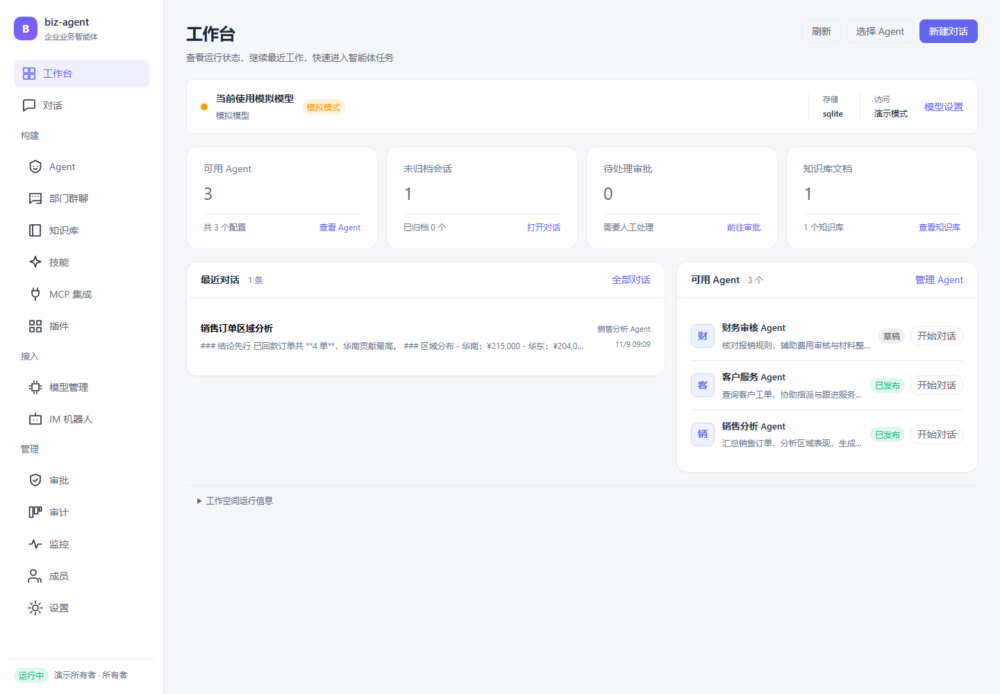
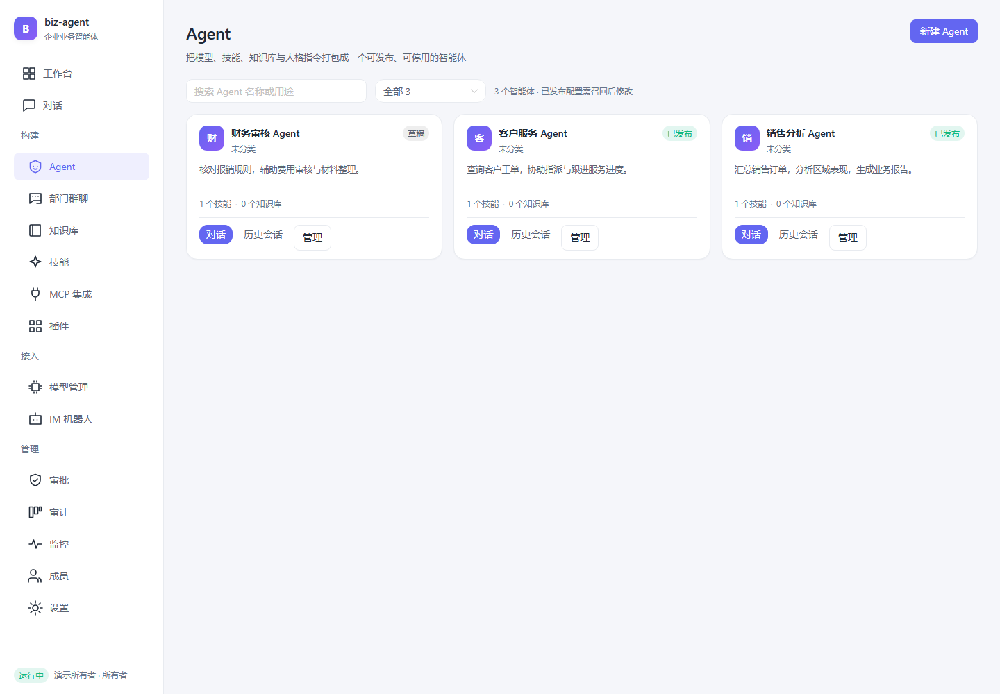
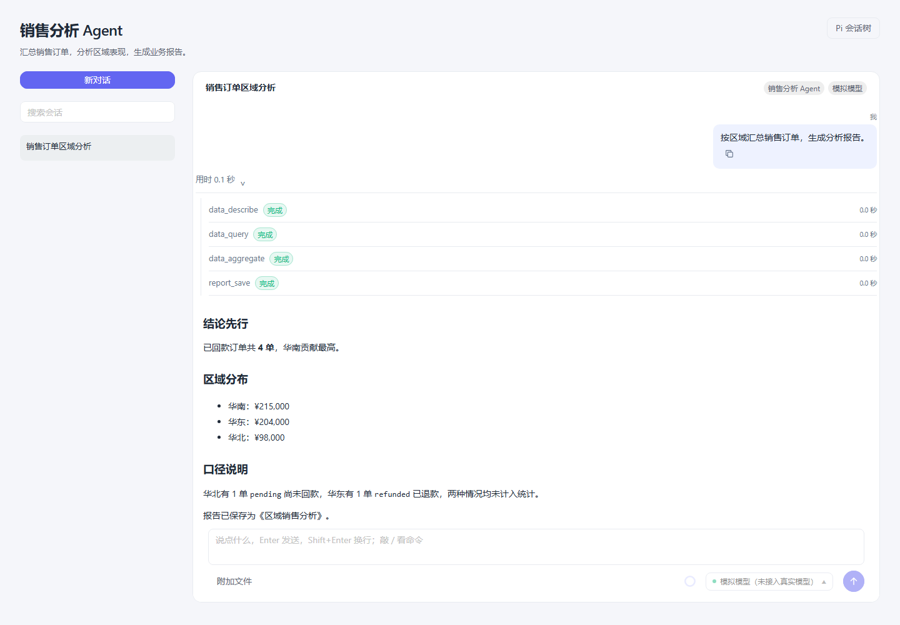
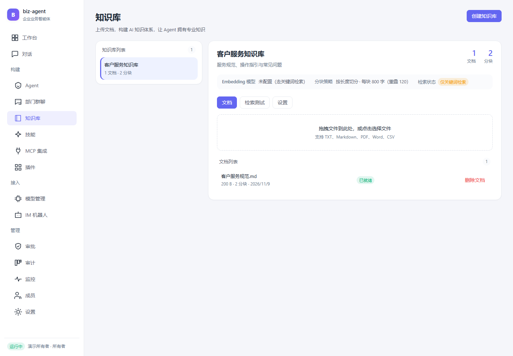
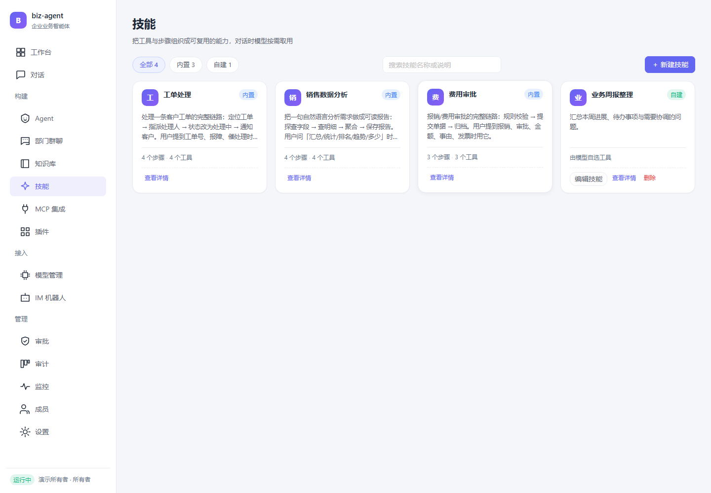

# biz-agent

**企业业务智能体平台**

biz-agent 将 AI 对话、企业知识和业务工具集中在一个工作空间。你可以创建面向不同岗位的 Agent，为它配置职责、模型、知识库与技能，通过对话查询信息、分析数据、处理业务，并查看每一步的执行过程。

平台提供 Agent 发布管理、部门群聊、知识库、技能与插件、模型管理、MCP 工具接入、IM 机器人，以及审批、审计和运行监控。

## 系统概览

工作台集中展示可用 Agent、最近对话、待处理审批和知识库文档，方便继续已有任务或发起新的业务对话。

> 本文截图来自隔离的演示环境，使用示例数据与模拟模型展示界面和业务执行过程。实际回答和执行效果取决于接入的模型、知识资料与业务工具。

## 核心功能

### 创建与发布 Agent

为销售分析、客户服务、财务审核等岗位创建专属 Agent，统一配置名称、职责指令、模型、技能和知识库，并按需要调整记忆与执行设置。

- 支持草稿编辑、测试、发布、停用和召回。
- 发布后的 Agent 拥有独立对话入口，历史会话按 Agent 管理。
- 已发布配置需召回草稿后修改，停用后保留历史记录。
- 每个 Agent 可以组合不同的模型、资料与技能，适应各自的业务职责。

### 通过对话完成业务任务

在普通对话中处理临时问题，也可以进入已发布 Agent 的专属页面开展工作。对话支持流式回复、附件、Markdown 内容、代码块与复制操作。

- **执行过程可见**。逐轮展示任务耗时，展开工具记录可查看调用状态、参数、结果和耗时。
- **快捷使用技能与命令**。输入 `/` 查找技能，切换模型、调整推理强度、压缩上下文或查看会话统计。
- **延续长任务**。查看上下文用量，使用手动或自动摘要压缩，并保留可见的历史对话与压缩标记。
- **探索不同分支**。通过 Pi 会话树查看历史节点、添加标签、切换分支，或从用户消息创建独立对话。
- **整理与分享会话**。支持搜索、置顶、重命名、归档、复制会话，以及导出会话历史和 HTML 报告。

### 部门群聊协作

把多个已发布的部门 Agent 加入同一条群聊，围绕共同事项逐部门发言。例如，销售提出需求，财务结合前序意见补充审核建议。

各部门保留独立会话上下文，群聊展示参与成员、每轮讨论和回复进度，重新打开后可以继续查看已有讨论。

### 企业知识库

将企业制度、服务规范、产品资料和常见问题整理成知识库，供 Agent 在回答和执行任务时检索参考。

- 支持上传 TXT、Markdown、PDF、Word 和 CSV 文件。
- 查看文档处理状态，使用实际业务问题试跑检索。
- 支持关键词与语义检索，并可按需要重新生成文档向量。
- 为 Agent 或技能绑定知识库，也可设置普通对话的默认检索范围。
- 查看命中内容与来源位置，回到原文核实依据。

### 技能与插件

将可复用的业务方法整理成技能，写明适用场景和作业指导书。需要固定执行顺序时，可配置步骤与可用工具。

对话中可以加载、切换或退出技能，模型也可以根据任务选择合适的技能。内置示例覆盖工单处理、销售数据分析和费用审批。

插件用于安装和管理扩展能力，支持插件清单、Pi 技能内容和 GitHub 公开技能目录导入，并提供启用、停用和卸载操作。

### 模型与外部工具接入

| 能力 | 可以完成的操作 |
| --- | --- |
| 模型管理 | 管理供应商、对话模型与向量模型，测试连通性，设置默认模型及最大上下文，按会话选择模型 |
| MCP 集成 | 注册外部工具服务，发现与管理工具，查看参数说明并测试调用，让 Agent 使用已接入的能力 |
| IM 机器人 | 管理钉钉和企业微信机器人，将企业消息渠道接入 Agent 对话，并提供测试发送入口 |
| 开放接口 | 管理调用密钥，将 Agent 对话能力接入其他应用 |

### 审批、权限与运行管理

| 模块 | 功能 |
| --- | --- |
| 审批 | 集中查看跨会话待办，批准或拒绝需要人工确认的工具操作，处理后继续执行 |
| 成员 | 管理成员账号、角色、启用与停用状态，按角色控制可访问功能 |
| 审计 | 查询平台操作与工具执行记录，通过筛选和详情追溯具体动作 |
| 监控 | 查看调用量、成功与失败情况、耗时统计和调用链详情，定位执行中的问题 |
| 设置 | 查看工作空间状态，管理默认模型、对话压缩设置与调用密钥 |

## 业务场景

| 场景 | 使用方式 |
| --- | --- |
| 客户服务 | 查询工单、核实问题、指派处理人员、更新状态并通知客户 |
| 销售分析 | 查询订单，按区域汇总数据，整理分析结果并生成报告 |
| 费用审批 | 核对规则、提交申请，经人工确认后继续办理与归档 |
| 内部知识问答 | 检索制度、产品资料和操作规范，结合来源内容回答问题 |
| 跨部门协作 | 组织多个岗位 Agent 围绕同一事项讨论，汇集各部门意见 |

工单、订单和报销示例用于体验业务能力。接入企业系统后，可以使用相应工具处理实际业务。

## 使用流程

1. **准备模型与工具**。在模型管理中配置可用模型，按业务需要接入外部工具服务。
2. **整理知识与技能**。上传企业资料，将常用业务方法整理成技能。
3. **配置并发布 Agent**。明确岗位职责，绑定模型、知识库与技能，测试后发布。
4. **开始业务对话**。从工作台或 Agent 页面进入会话，提出任务并查看执行过程。
5. **跟进与管理**。处理审批、查看运行记录，或组织多个 Agent 参与部门群聊。

平台支持桌面和窄屏布局，便于在不同屏幕上查看任务、继续对话和处理待办。
